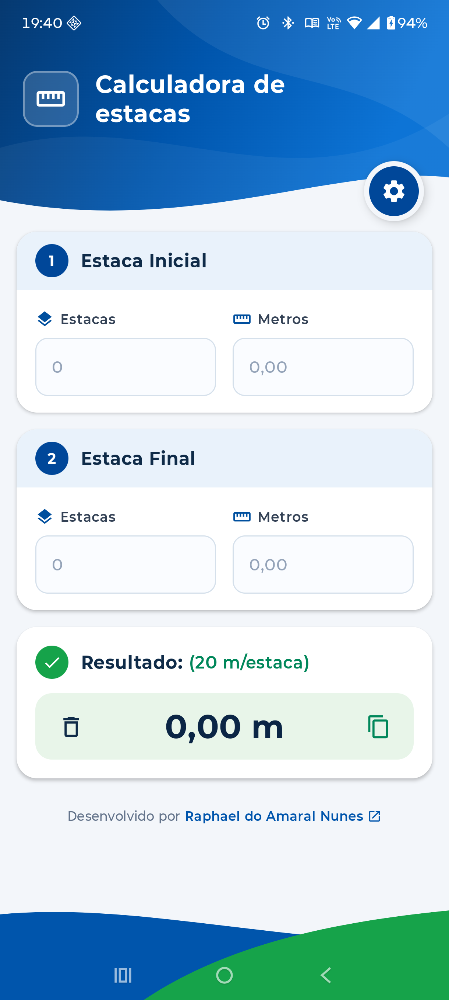

# Calculadora de Estacas 📐

Aplicativo Android para cálculo ágil de distâncias entre estacas topográficas em obras de infraestrutura, rodovias e terraplenagem.

<p align="center">
  
</p>

## ✨ Funcionalidades

- **Cálculo em Tempo Real:** Distância precisa a partir da estaca inicial e final com fração em metros.
- **Configuração Customizável:** Ajuste do espaçamento por estaca (padrão 20 m) e opção para permitir valores negativos.
- **Ações Rápidas:** Copiar resultado para a área de transferência ou limpar campos com um toque.
- **Interface Moderna:** Construída em Material 3 com cards por etapas e suporte a telas *Edge-to-Edge*.
- **100% Offline:** Funciona sem internet, sem anúncios e sem coleta de dados.

## 🧮 Lógica de Cálculo

$$\text{Distância (m)} = (\text{Estaca Final} - \text{Estaca Inicial}) \times \text{Metros por Estaca} + \text{Metros Final} - \text{Metros Inicial}$$

## 🛠️ Tecnologias

- **Linguagem & UI:** Kotlin, Jetpack Compose (Material 3)
- **Arquitetura:** MVVM, Clean Architecture, StateFlow
- **Persistência & Testes:** Jetpack DataStore Preferences, JUnit 4

## 📲 Download e Instalação

Baixe o arquivo `.apk` pronto para instalar na aba de [**Releases**](https://github.com/raphael-amaral/CalculadoraEstacasMobile/releases).

Para gerar o APK localmente via código-fonte:
```powershell
.\gradlew.bat assembleDebug
```
O arquivo estará disponível em `app/build/outputs/apk/debug/app-debug.apk`.

## 👤 Autor

Desenvolvido por [Raphael do Amaral Nunes](https://github.com/raphael-amaral).
